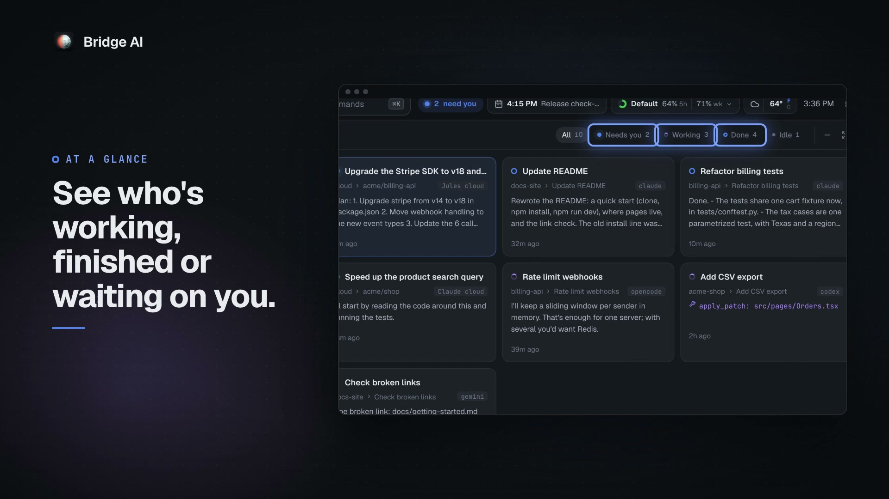

# Bridge AI

**The bridge between you and your AI agents.** Tell a chief of staff what you need and it hands the work to the right agent, while your agents (Claude Code, Codex, Gemini CLI, Copilot, OpenCode and others, plus cloud agents) work in parallel. Spaces keep every project organized, and one window holds every provider, on your computer and your phone.

Bridge AI runs on your machine. Your agents use their own logins; Bridge AI only reads their screens and transcripts and types into them for you. Nothing is sent anywhere else.

[](https://sahil1.github.io/bridge/)

**[Download](https://sahil1.github.io/bridge/)** for macOS, Windows or Linux · **[Try the demo](https://sahil1.github.io/bridge/demo/)** in your browser, with made-up agents · [All releases](https://github.com/sahil1/bridge/releases/latest)

## Install

The app needs nothing else installed: no Node, no clone. Bridge AI finds the agent CLIs you already have and offers to install one if you have none.

### macOS

Paste this in Terminal:

```bash
curl -fsSL https://raw.githubusercontent.com/sahil1/bridge/main/install.sh | sh
```

It downloads the app for your Mac (Apple Silicon or Intel), puts it in Applications and opens it, in a few seconds. Run it again to update.

Prefer a download? Get `Bridge-AI-mac-arm64.dmg` (Apple Silicon) or `Bridge-AI-mac-x64.dmg` (Intel) from [Releases](https://github.com/sahil1/bridge/releases/latest) and drag Bridge AI to Applications. The app isn't signed by Apple yet, so macOS asks before the first open: click Done, then System Settings › Privacy & Security › **Open Anyway**. The install command above skips that step.

### Windows

Paste this in PowerShell:

```powershell
irm https://raw.githubusercontent.com/sahil1/bridge/main/install.ps1 | iex
```

It installs Bridge AI for your user (no admin needed), adds it to the Start menu and opens it. Run it again to update. Or download `Bridge-AI-win-x64.exe` from [Releases](https://github.com/sahil1/bridge/releases/latest); it isn't signed yet, so SmartScreen may ask first: **More info › Run anyway**.

### Linux

The same command as macOS:

```bash
curl -fsSL https://raw.githubusercontent.com/sahil1/bridge/main/install.sh | sh
```

On Debian and Ubuntu it installs the `.deb` (it asks for your password); elsewhere it puts the AppImage in `~/.local/share/bridge-ai` with a menu entry and a `bridge-ai` command. 64-bit Intel/AMD only for now. Both files are also on the [Releases](https://github.com/sahil1/bridge/releases/latest) page.

### From source

You need [Node.js](https://nodejs.org) 20 or newer and at least one agent CLI installed (for example [Claude Code](https://docs.claude.com/en/docs/claude-code) or [Codex](https://github.com/openai/codex)).

```bash
git clone https://github.com/sahil1/bridge.git
cd bridge
npm start
```

Open http://127.0.0.1:7420. The first start installs dependencies and builds the UI, which takes a minute.

The first time you open it, Bridge AI looks at what's already on your computer: the agent CLIs you have and whether you're signed in to them (your Claude, ChatGPT or Gemini subscriptions keep working as they are), your name and your time zone. Change anything that's off right there, then **Finish setup** saves it and starts your chief of staff; **More options** lets you pick a default agent too. If no agent is installed yet, it offers to install one in a terminal tab you can watch. Then a short tour points out the main parts of the app (the phone gets its own); take it again any time from Settings › About & updates or `⌘K`.

```bash
npm start -- dev     # hot reload: open :7421; UI edits appear live, server edits restart the API
npm run desktop:dev  # the desktop app with hot reload (runs next to the installed app)
npm start -- phone   # also publish over Tailscale HTTPS for your phone
npm run stop         # stop the server; agents keep running (npm run stop -- agents stops them too)
```

### From your terminal

Run `npm link` once in the repo to get the `bridge-ai` command:

```bash
bridge-ai list              # every agent and shell, numbered
bridge-ai attach 2          # work in one from this terminal (or: bridge-ai attach "api tests"); Ctrl+] detaches
bridge-ai attach            # pick from a list
bridge-ai open              # open the app in your browser
bridge-ai start / stop
bridge-ai status            # is it running, which agents, the relay and paired phones
bridge-ai relay setup       # your phone relay, with a Cloudflare API token (no browser needed)
bridge-ai pair              # pair a phone: QR code, link and code, right in the terminal
bridge-ai phones            # paired phones (bridge-ai phones remove <name>)
```

Attaching gives you the agent's real terminal, in your terminal app, with its keys, fonts and scrollback, the way `tmux attach` or `herdr` does. The agent keeps running in Bridge AI when you detach, and the app stays in sync. The terminal button on each agent (and "Open in terminal app" in the sidebar menu) opens the same thing in Ghostty, iTerm, Warp, WezTerm, kitty, Alacritty or Terminal on macOS, your terminal on Linux, or Windows Terminal; pick which in Settings › General. With the herdr runtime, `attach` focuses the agent and opens herdr.

## What works where

| | macOS | Linux | Windows |
|---|---|---|---|
| Agents, chat, terminal, files, changes, chief of staff | ✓ | ✓ | ✓ |
| herdr runtime and the live Herdr view | ✓ | ✓ | (herdr isn't on Windows) |
| Desktop app | ✓ | ✓ | ✓ |
| Inbox (Apple Mail) and Calendar (macOS Calendar) | ✓ | not yet | not yet |

Day-to-day use so far has been on macOS. Linux and Windows use the same code paths (node-pty and Electron both support them) but have had little testing, so please open an issue if something breaks. On Linux the server has been tested mostly in the [Docker image](#run-it-on-an-always-on-machine) (Debian, amd64 and arm64): agents, terminals, git, sign-in and pairing a phone. On a Linux machine with no desktop, **Sign in** for Codex uses its device code login, since there's no browser to come back to.

## Agents

Bridge AI finds the agent CLIs on your PATH. Each one is described in [`server/agents.js`](server/agents.js): how to start it, how to resume a session, and what its screen looks like while it works.

| Agent | Command | Chat view | Extras |
|---|---|---|---|
| Claude Code | `claude` | ✓ | subagents, slash commands, question cards, safe sending |
| Codex | `codex` | ✓ | slash commands, question cards, safe sending |
| Gemini CLI | `gemini` | terminal | |
| GitHub Copilot CLI | `copilot` | terminal | |
| OpenCode | `opencode` | terminal | |
| Cursor Agent | `cursor-agent` | terminal | |
| Grok | `grok` | terminal | |
| Amp | `amp` | terminal | |
| Qwen Code | `qwen` | terminal | |
| Aider | `aider` | terminal | |
| Goose | `goose` | terminal | |
| Muse Code (Meta) | `muse` | terminal | |
| Crush | `crush` | terminal | |

Agents without a chat view work fully in the Terminal tab, and their status (working, waiting on you, finished) still shows in the sidebar. Adding an agent, or a chat view for one, is a small change; see [CONTRIBUTING.md](CONTRIBUTING.md).

## Cloud agents

Some providers run coding agents on their own computers, on a repo they host, and keep going while your computer sleeps. Add your key in Settings › Model providers › Cloud agents, then start one from New agent › In the cloud: pick the provider, the repo and a branch, and say what to do. They show up in a Cloud space in the sidebar with the same dots (working, waiting on you, done) and the same notifications, here and on your phone. Chat shows what the agent said and did, the message box sends follow-ups, and the header has Stop and the pull request. The chief of staff sees them too.

| Provider | How it works | Key | Cost |
|---|---|---|---|
| Cursor | Cursor Cloud Agents API. It pushes a branch and opens a pull request | API key from [cursor.com/dashboard/api](https://cursor.com/dashboard/api) | Your Cursor plan |
| GitHub Copilot | Bridge AI opens an issue with your task and assigns it to Copilot, which works in a draft pull request. Follow-ups are `@copilot` comments there | A fine-grained token (Metadata: read; Actions, Contents, Issues and Pull requests: read and write), or your GitHub CLI sign-in | Your Copilot plan |
| Jules | Jules API, on a repo you've connected to Jules. You can ask to see its plan first | API key from [jules.google.com/settings](https://jules.google.com/settings#api) | Your Jules plan |
| Claude | Claude Managed Agents, with your repo mounted. It pushes a branch | API key from the [Claude Console](https://platform.claude.com/settings/keys), plus an optional GitHub token for private repos and pushing | Pay per use on your Claude Console account, not your Pro or Max plan |

Bridge AI checks on running agents every 10 to 20 seconds, less often when several run at once or once they wait or finish, and backs off when a provider asks it to slow down or has trouble. Copilot and Jules have no stop in their APIs, so Stop for those is on their own pages. The provider code is in [`shared/cloud/`](shared/cloud/) and uses only `fetch`, so the phone apps run it too.

**With no computer**: the iPhone and Android apps have Cloud agents on their start screen. Add your key on the phone and start and follow agents from there. Keys stay on the phone (iPhone's Keychain, Android's Keystore) and go only to their own provider; the phone keeps its own keys and agents, apart from your computer's. Android checks on them in the background and notifies you; iPhone checks while the app is open. More in [mobile/README.md](mobile/README.md#cloud-agents).

## Runtimes: where agents run

| Runtime | What it is | When it's used |
|---|---|---|
| **Built in** | Bridge AI runs each agent in its own terminal (node-pty, with a headless xterm keeping the screen). Nothing else to install. The terminals live in a small terminal host process, so agents keep running when Bridge AI quits, restarts or updates, and it picks them up as they are, screen and scrollback included. After a reboot, Claude Code and Codex sessions resume where they were. | Default |
| **herdr** | [herdr](https://herdr.dev) is a terminal multiplexer for agents. Bridge AI drives it, and you get herdr's own terminal UI, split panes and the live Herdr view (`Alt+2`) in the browser. | Optional. Only when you choose it; install herdr separately |

Choose in Settings › General › Where agents run, or set `"runtime": "builtin"` or `"herdr"` in your config. herdr is never required, and Bridge AI won't switch to it just because it's installed.

To have built-in agents stop with Bridge AI instead, turn off **Keep agents running when Bridge AI quits** there (`"keepAgents": false`); they resume next time, as after a reboot. **Quit and Stop Agents** in the app's menu, or `npm run stop -- agents`, stops them either way. On Windows an app update still stops them (Windows can't replace a running program) and they resume after it; in the Docker image they stop and resume with the container.

The terminal host listens on no network. Bridge AI reaches it over a socket in a folder only you can open (a named pipe on Windows) and must give it a random token first. It exits by itself once it has no agents and no Bridge AI to keep them for.

Bridge AI joins the herdr session you already have running. It shows the agents and panes in it, and anything you start from Bridge AI opens there too, so you see it in herdr as well.

**Several sessions** (`herdr --session work`): the session menu at the top of the sidebar (on the phone, at the top of Agents) lists every session herdr knows, running or not, with how many agents wait on you in each. Pick one and the agent list, the board and the Herdr view switch to it at once. The pick is saved as `herdr.session`, the same setting as Settings › General › Where agents run, so the two stay in step. From the menu you can also:

- start a new session in the background (herdr's headless server, `herdr --session <name> server`), or start a stopped one again with its saved layout;
- stop one (`herdr session stop`), after you confirm. Bridge AI refuses while any agent in it is working or waiting on you;
- open one in your terminal app (`herdr session attach`). If a new session can't start in the background, the menu offers this instead.

Each session keeps its own open tabs, queued messages and muted agents. Notifications cover the session you're looking at, and switching never announces anything: agents in the other sessions are out of view, not finished. herdr notes that a server started from a background job may not reach the macOS Keychain; if a tool in a session started here can't, stop it and start it from your terminal. To watch two sessions side by side, run a second copy of Bridge AI with its own data folder and port (`BRIDGE_HOME=~/.bridge-ai-work BRIDGE_PORT=7430 npm start`).

## Your data and settings

Everything personal lives in `~/.bridge-ai` (set `BRIDGE_HOME` to move it), never in the repo:

| File | What it holds |
|---|---|
| `config.json` | Your settings (see below) |
| `chief/` | The chief of staff's folder: its instructions, `state/playbook.md` (what it has learned about how you work), `state/ledger.md` (its hand-offs), `state/tasks.md` (tasks it does itself) and `work/` (what it makes for them) |
| `routines.json`, `ideas.md` | Recurring jobs and your ideas backlog ([`routines.example.json`](routines.example.json) shows the shape) |
| `runtime.json` | Spaces and tabs for the built-in runtime |
| `host/` | The terminal host's token, socket and log (built-in runtime), readable only by you |
| `cloud-keys.json`, `cloud-agents.json` | Your cloud agent keys (readable only by you, never given to the agents on your computer) and the cloud agents you started |
| `cache/` | Queued messages, watchlist, uploads, mail rules |

Settings start from [`config.example.json`](config.example.json). Put yours in `~/.bridge-ai/config.json`; [`config.local.example.json`](config.local.example.json) shows the shape.

| Key | What it does |
|---|---|
| `name` | What the chief of staff and the morning brief call you |
| `defaultAgent` | Agent used when none is picked (`claude`, `codex`, `gemini`, ...) |
| `chief.kind` | Agent the chief of staff runs on |
| `runtime` | `builtin` (default) or `herdr` |
| `keepAgents` | Built-in agents keep running when Bridge AI quits, restarts or updates (default `true`). Also in Settings › General |
| `herdr.session` | Which herdr session Bridge AI shows when you run more than one (`herdr --session work`). Unset: `main`, else the latest one running. Switch from the sidebar's session menu or Settings › General; applies at once |
| `port` | Default 7420 |
| `location` | `{ label, lat, lon, timezone }` for weather and the brief |
| `mail.myDomains` | Your organisation's email domains, so colleagues aren't marked External |
| `assistant.cwd` | Folder that mail and meeting agents start in (point it at notes that describe you) |
| `market`, `mortgage` | Watchlist and an optional mortgage card |
| `allowedHosts` | Extra host names allowed to reach the server (Tailscale `*.ts.net` names are allowed already) |

You rarely need to edit the file by hand. **Settings** (the gear in the top bar, or `⌘,` / `Ctrl+,`) has:

| Section | What's there |
|---|---|
| General | Your name, default agent and default model, which agent runs the chief of staff, your location (from your device or a city search), where agents run |
| Agents | Every supported agent: installed or not, signed in or not, one-click install, start a chat |
| Model providers | API keys, cloud accounts and local model servers (Ollama, LM Studio) your agents can use, and your keys for cloud agents |
| MCP servers | The tools your agents can call, across all of them, with a catalog of 35 popular servers by category (web search, docs and notes, planning, Microsoft 365, deploy and monitoring, data, design) |
| Appearance | Theme, color mode, text size, density, font |
| Config file | Your `config.json`, editable, checked before it's saved, with the effective settings and defaults beside it |

## What's in the app

- **Sidebar**: spaces and tabs with each agent's status, folder and git branch. Drag to reorder, double-click to rename.
- **Tabs**: open any agent as a tab, drag tabs to reorder, put two side by side.
- **Own branch** (optional, per repo): start an agent on a new branch in its own git worktree, kept in `~/.bridge-ai/worktrees`, with the ignored files listed in `.worktreeinclude` (like `.env`) copied in and your setup command (like `npm install`) run first. Closing it removes the folder only if nothing would be lost; the branch stays.
- **Each agent** has Chat (its transcript), Terminal (a live mirror you can type in), Files (a read-only browser with syntax highlighting and markdown) and Changes (git status and diffs).
- **Review and ship**: in Changes, click lines of a diff to comment and send all your comments to the agent as one message; commit and push, and open a GitHub pull request (with `gh`) drafted from your commits, then watch its checks there.
- **Message box**: `@` to reference files and folders, `/` for slash commands, ↑ for earlier messages, voice notes (whisper.cpp, on your machine) and attachments. Messages to a busy agent are queued and sent when it's free.
- **Questions and approvals** from an agent show as cards you can click. That includes the questions Codex asks while it keeps working: the agent shows as needing you, and the card stays until you answer, even after Codex's own screen has dropped the question at the end of its turn.
- **What each reply changed**: "Changed 3 files" under a reply opens its own diff per file. With Claude Code, **Undo this reply** puts the files and the chat back to just before your message, without sending anything.
- **Subagents** that Claude Code starts show live above the message box.
- **Consult other models**: the chief of staff (or you, with `node ~/.bridge-ai/chief/bin/bridge ask`) can put a one-off question to Grok, GPT, Claude, Gemini, Muse Spark, Perplexity, DeepSeek, a local Ollama model and others, for a second opinion, live news, or a very long document. It uses each agent's CLI and your existing subscription where it can, and an API key from Model providers otherwise. Settings › Agents shows who is reachable and how.
- **Plain chats**: talk to Claude, Codex or any agent directly, like its own app, with no project folder (New agent › Plain chat, or New chat in `⌘K`).
- **Several accounts**: a work and a personal Claude (or Codex), running side by side. **Add another account** is in the usage chip's menu in the top bar, in New agent's Account row and in `⌘K`: name it, sign in right there (the agent's own login, for that account only), then start an agent on it. Each agent shows the account it's on and keeps it when you fork or reopen it, and its ⋯ menu can continue the conversation on another account. An account keeps only its own login; settings, skills and history stay shared.
- **Hand off to another agent**: the model chip in the message box also lists your other installed agents and whether each is signed in. Pick one (Claude Code to Codex, say) and it starts in the same folder, on the same branch or worktree, on the account and model you choose. Agents can't open each other's conversations, so it starts with a handover Bridge AI builds from the transcript and git: your goal, the recent messages, changed files, where it stopped and what's still open (or, if you ask, the old agent's own summary). You can read it before it goes. The old agent goes to Closed agents unless you keep it open too. In the chief of staff's chat, the same menu switches the agent the chief runs on.
- **Chief of staff**: tell it what you need. Project work goes to the agent already on that topic, or a new one, and it tells you when that's done. Standalone tasks it does itself: questions and research, drafts (emails, docs, plans, summaries), checklists and planning. It writes only in its own `work/` folder and never edits your projects. Its own tasks are in a Tasks panel above its message box: add one there to send it to the chief, mark one done or reopen it, and open what a finished task produced. The morning brief mentions its open tasks. It learns where work lives and how you like things done, in a playbook you can read and edit.
- **Today**: schedule, inbox ranking, morning brief, routines, ideas, usage and quota, weather, markets and news.
- **Usage**: tokens and cost per day, model and project, with a year heatmap (from your agents' local logs via ccusage).
- **Phone**: the same app on your phone, as a Home Screen app with notifications. See [On your phone](#on-your-phone).
- **Appearance**: Slack-style themes that color the window frame, light and dark modes, and custom colors you can share as a string.

## The demo

Bridge AI's own UI on made-up agents, spaces and data, with no computer or install behind it. It's what **Try the demo** opens in the phone apps.

```bash
npm run demo:build   # a static site in dist-demo/
```

`dist-demo/` is plain files with relative paths, and nothing in it loads from the network, so any static host can serve it, from any folder. The agents work, ask and reply on a script ([src/demo/](src/demo)); what needs a real computer (voice notes, your terminal app, pairing a phone, updates, adding accounts) says so in one line.

## Desktop app

`desktop/` wraps Bridge AI in an app window with a badge for agents that need you, notifications, and a global shortcut (`Alt+Cmd+A` on macOS, `Alt+Ctrl+A` elsewhere; change it with `desktop.shortcut` in config).

```bash
npm run desktop          # run it from your clone
npm run desktop:dev      # same, with hot reload
npm run desktop:dist     # build an installer to share
```

### Build it to share

`npm run desktop:dist` builds a self-contained app: Bridge AI's server, the UI and their dependencies go inside it, and it runs on the app's own Node. The people you give it to don't need Node, npm or a clone. They only need the agent CLIs they want to use (Claude Code, Codex, ...), and onboarding offers to install those. Nothing of yours goes in: settings, history and the chief of staff's memory live in each person's own `~/.bridge-ai`.

| Build on | You get (in `desktop/dist/`) |
|---|---|
| macOS | `Bridge-AI-mac-arm64` (Apple Silicon) and `Bridge-AI-mac-x64` (Intel), each as `.dmg` and `.zip`. The `.zip` files are what `install.sh` downloads. |
| Windows | `Bridge-AI-win-x64.exe` |
| Linux | `Bridge-AI-linux-x86_64.AppImage` and `Bridge-AI-linux-amd64.deb` |

To publish a release:

1. Set the new version in `package.json` and `desktop/package.json`, and add a `## <version>` section to [CHANGELOG.md](CHANGELOG.md).
2. Commit, merge to `main`, and check out `main`.
3. `npm run release`.

`npm run release` checks that `main` has your code, the changelog has that version, and the tag is new, then pushes the tag `v<version>`. GitHub Actions ([release.yml](.github/workflows/release.yml)) builds the app on macOS, Windows and Linux, starts each build and checks it works (`scripts/smoke.js`), and publishes the release with every installer, checksums, and the changelog section as notes. It takes about 15 minutes; if any platform fails, nothing is published. Try `npm run release -- --dry-run` first.

You can also run the builds without releasing: Actions › Release › Run workflow. The installers are attached to the run.

## On your phone

Bridge AI works on your phone as an app on the Home Screen, with notifications when an agent needs you or finishes. It's the same app, served by your computer, so you don't need an app store; there are also iPhone and Android apps ([mobile/](mobile)) that add a lock-screen card and a demo. There are two ways to reach your computer; both are optional, and Bridge AI works the same on the computer without either.

### From anywhere, through your own relay

A small relay ([relay/](relay)) runs on your own free Cloudflare account. Bridge AI keeps one outgoing connection to it, and your phone reaches your computer through it. There's no VPN to keep connected, nothing to install on the phone, and no port opened on the computer.

1. In Bridge AI, open **Settings › Phone & notifications** and click **Sign in with Cloudflare** (or use an API token made with Cloudflare's "Edit Cloudflare Workers" template). Bridge AI deploys the relay to your account. Its sign-in is kept apart from any other Cloudflare tools you use.
2. Click **Pair a phone** and scan the QR code with the phone's camera (or open the relay's address and type the code).
3. Add it to the Home Screen: iPhone, Share › **Add to Home Screen**; Android, ⋮ › **Install app**. Open it from there, and type the code again if it asks.
4. In Bridge AI on the phone, go to **Settings › Phone & notifications** and click **Turn on notifications**.

Everything between the phone and the computer is end-to-end encrypted ([relay/web/link.js](relay/web/link.js)): each paired phone has its own key, kept on the phone, and each connection makes fresh keys. The relay, and Cloudflare, see when and how much, never what. It stores when your computer was last online, and messages waiting for your computer (below), sealed so it can't read them. Remove a phone in Settings and it's out. A phone can't pair other phones or change the relay; that's done on the computer.

Your computer has to be on and Bridge AI running. **Keep this computer awake while it's plugged in** (macOS and Linux) stops it sleeping. When it's off or asleep, the phone shows what it last sent (your agents, recent chats, usage, the brief) under a banner saying so. A message you send an agent then, or an answer to its question, waits in your relay, sealed for your computer, and goes through when the computer is back, even if you've closed the phone by then; it says "Waiting for your computer", then "Delivered". Anything else needs the computer on. Messages wait 7 days at most. The free Cloudflare plan is plenty for one person; if it's ever used up, Cloudflare stops serving until the next day rather than charging you.

### Through Tailscale

If you already use [Tailscale](https://tailscale.com), a free private network between your own devices:

1. On the computer: install Tailscale and sign in. In Bridge AI, open **Settings › Phone & notifications** and click **Turn on phone access**. It shows a QR code.
2. On the phone: install Tailscale and sign in with the same account. Scan the QR code with the camera.
3. Add it to the Home Screen and turn on notifications, as above.

Only devices signed in to your Tailscale account can reach Bridge AI; nothing is opened to the internet.

Either way, choose what you're notified about in Settings › Phone & notifications: an agent needs you, an agent finished, and usage running low (5 to 25% left). Notifications are encrypted end to end to your phone. iPhone needs iOS 16.4 or later for notifications.

- **What it's asking**: a "needs you" notification shows the agent's question or permission request, and tapping it opens that agent at its question.
- **Answer buttons**: on Android and in Chrome on a computer (not iPhone), a yes or no question, or one with two short choices, gets buttons that answer it without opening the app. Each works once, for 10 minutes, and only if the agent is still asking that same question; otherwise Bridge AI opens. Turn them off in Settings › Phone & notifications.
- **Quiet while you're at the computer**: while Bridge AI is in front on your computer, or you typed or clicked in it in the last 2 minutes, your phone isn't notified (the computer's own notifications still are). **Notify my phone even when I'm at the computer** changes that.
- **Mute an agent**: ⋯ › **Mute notifications** in its header or the sidebar, until you unmute it.

## Run it on an always-on machine

Run Bridge AI on a machine that stays on, and your agents keep working with your laptop closed. Your phone pairs with it like with any other computer, through your relay.

| Machine | What to know | Rough cost |
|---|---|---|
| A Mac mini at home | The simplest: install the app as usual | The Mac, plus a few dollars of power a month |
| A Raspberry Pi 5 | Small and quiet. Get 8 GB of memory, with Raspberry Pi OS (64-bit) and Docker | About $100 once |
| A cloud server | Nothing at home to look after. 2 CPUs and 4 GB of memory or more, Ubuntu or Debian with Docker | About $10 to $25 a month |

Agents need memory (Claude Code asks for 4 GB), so give the machine more if you run several at once.

### A Mac mini

Install Bridge AI as above. In **Settings › Phone & notifications** set up the relay, pair your phone and turn on **Keep this computer awake while it's plugged in**. Turn on **Open at Login** in the Bridge AI menu, and in System Settings turn on **Start up automatically after a power failure** (Energy) and automatic login (Users & Groups), so it comes back by itself after a power cut.

### Linux, a Raspberry Pi or a cloud server: Docker

[Install Docker](https://docs.docker.com/engine/install/), then:

```bash
mkdir bridge-ai && cd bridge-ai
curl -fsSLO https://raw.githubusercontent.com/sahil1/bridge/main/docker-compose.yml
docker compose up -d
docker compose exec bridge bridge-ai relay setup   # once: your relay, with a Cloudflare API token
docker compose exec bridge bridge-ai pair          # shows a QR code: scan it with your phone
```

`relay setup` asks for a Cloudflare API token. Make one at [dash.cloudflare.com/profile/api-tokens](https://dash.cloudflare.com/profile/api-tokens): **Create Token**, then the **Edit Cloudflare Workers** template, or a custom token with only **Account › Workers Scripts › Edit** and **Account › Account Settings › Read**, for your account. Bridge AI keeps it in its data folder (readable only by you) to update the relay later. `pair` prints the QR code, the link and the code to type; then finish on the phone as in [On your phone](#on-your-phone).

- **What's in it**: Node, git, `gh` and Bridge AI's server, for 64-bit Intel/AMD and Arm. It runs as a normal user, not root.
- **What's kept**: three volumes. Your home folder in the container (every agent's sign-in, git and SSH settings, agents you install), Bridge AI's data folder, and `~/code` for your repos.
- **Restarts**: after a crash or a reboot it starts again and reconnects to the relay. `docker compose exec bridge bridge-ai status` shows how it's doing.
- **Updates**: `docker compose pull && docker compose up -d`.
- **No open port**: your phone comes in through the relay. For a browser on that machine or over `ssh -L 7420:127.0.0.1:7420`, see the comments in [docker-compose.yml](docker-compose.yml); the port stays on 127.0.0.1.

Without Docker, the server runs on its own too: clone the repo, `npm link`, then `bridge-ai start` (the same as `npm start`, no app window). The commands above work the same way (`bridge-ai relay setup`, `bridge-ai pair`, `bridge-ai status`).

### Signing in to your agents

Install agents in **Settings › Agents** (from your phone is fine), or with `docker compose exec bridge npm install -g @anthropic-ai/claude-code @openai/codex`. They go in your home folder, so they stay through image updates and can update themselves. You can also bake them into your own build of the image: see the `AGENTS` setting in the [Dockerfile](Dockerfile).

The machine has no browser, so a sign-in shows a link that you open on your phone or laptop. On the phone, **Settings › Model providers › Sign in** next to an agent runs its sign-in in a terminal tab you can type in. From a laptop, SSH to the machine and use `docker compose exec -it bridge bash`.

- **Claude Code**: `claude auth login` (or `/login` in Claude Code) shows a link. Sign in there, then paste the code the page shows at **Paste code here if prompted**. Or, with a Claude subscription, run `claude setup-token` on any computer with a browser and put the token it prints in docker-compose.yml as `CLAUDE_CODE_OAUTH_TOKEN` under `environment`. An `ANTHROPIC_API_KEY` works too. ([Claude Code docs](https://code.claude.com/docs/en/authentication))
- **Codex**: `codex login --device-auth` shows a link and a one-time code to enter there (Bridge AI's Sign in button uses it on a machine with no desktop). Turn on device code login in your ChatGPT security settings first; for a workspace, an admin does. Or use an API key: `printenv OPENAI_API_KEY | codex login --with-api-key`. ([Codex docs](https://developers.openai.com/codex/auth))

### Getting your code there

Put repos in `~/code`: agents start in folders inside the home folder. In a terminal on the machine (`docker compose exec -it bridge bash`), set your name for commits once (`git config --global user.name "Your Name"` and `user.email`), then either:

- **GitHub CLI**, for all your repos (and pull requests from Bridge AI): `gh auth login`, pick GitHub.com, HTTPS and "Login with a web browser", and open the link it shows on your phone with the one-time code. Then `gh repo clone you/your-repo ~/code/your-repo`.
- **A deploy key**, for one repo and nothing else: `ssh-keygen -t ed25519 -N "" -f ~/.ssh/id_ed25519`, add `~/.ssh/id_ed25519.pub` in the repo's **Settings › Deploy keys** (tick **Allow write access** so agents can push), then `git clone git@github.com:you/your-repo.git ~/code/your-repo`.

## Security

- The server listens on `127.0.0.1` only. It answers requests whose Host is this machine or a Tailscale name and, from a browser, whose Origin is too, so other web pages can't drive your agents through localhost.
- In Docker it runs as a normal user and publishes no port. If you publish one for a browser, bind it to 127.0.0.1 as [docker-compose.yml](docker-compose.yml) shows, never to the network.
- File and git actions stay inside the agent's folder. They change things only when you ask from the app: saving a file, undoing a change, committing, pushing (never forced) or opening a pull request.
- Anyone who can reach the server can type into your agents. Phone access uses your own relay, which only lets in phones you paired (end-to-end encrypted), or `tailscale serve`, which only devices on your tailnet can reach. Never expose Bridge AI with `tailscale funnel` or a public port.
- Mail and meeting agents are told that email text is data, not instructions, and never to send or post without your OK.

## Optional setup

Each of these shows up where it's needed, with one button that does it. Installs run in a terminal tab you can watch (in the Setup space), and the screen picks up by itself once it's done.

- **Signing in to your agents**: Bridge AI's first-run setup offers Sign in for Claude Code and Codex. An agent still on its own first-run screens (look, sign-in, trusting its folder) shows them as a card in its chat. Settings › Agents and the Usage card have Sign in too.
- **Voice notes**: tap the mic in the message box, on the computer or your phone. The first time, Bridge AI offers to set them up: it downloads the speech model (190 MB, to `~/.bridge-ai/models`) and, on a Mac, installs `ffmpeg` and `whisper-cpp` with Homebrew (and Homebrew first, if the Mac has none). Elsewhere, install `ffmpeg` and whisper.cpp's `whisper-cli` yourself. Speech is turned into text on your computer; audio never leaves it. If macOS has the microphone off for the app, the mic offers Allow access.
- **Inbox (macOS)**: Mail needs your account and one sync (the Inbox card's Open Mail), and Bridge AI needs Full Disk Access (Allow access). In the desktop app, Allow access opens System Settings with a tile beside it: drag Bridge AI from the tile into the list and turn it on. Restart to apply then appears at the top, for whenever it suits you.
- **Calendar (macOS)**: Install icalBuddy in the Calendar card (it offers Homebrew first when it's missing), then Allow access for Calendars when macOS asks.
- **Pull requests**: the Changes tab offers to install GitHub's `gh` and sign it in. On a Mac without Apple's developer tools, it offers those for git.
- **Agents' folders in Desktop or Documents**: if macOS was told no, the Files tab and New agent offer Allow access (Files & Folders).
- **Plan usage**: off until you turn it on (the Usage card, or Settings › General). It asks each provider how much of your plan is left, with the sign-in your agents use on this computer, through [quota-axi](https://www.npmjs.com/package/quota-axi). Some providers, Anthropic among them, don't allow other apps to use their sign-ins, so it's your call. For Claude, macOS asks once for Keychain access (the Usage card's Allow).
- **Weather**: the Weather card asks for your city when it doesn't know it.

Testing these without changing anything on your Mac: `BRIDGE_FIX_DRYRUN=1` makes Bridge AI log what it would open in System Settings instead of opening it.

## License, terms and privacy

[Apache-2.0](LICENSE). See [NOTICE](NOTICE).

Bridge AI is provided as is, with no warranty, and you're responsible for what your agents do and for following the terms of the services you connect ([TERMS.md](TERMS.md)). It's an independent project, not affiliated with or endorsed by Anthropic, OpenAI, Google, GitHub, Cursor, Cloudflare or any other company whose tools it works with; their names and logos belong to them. The project collects nothing about you ([PRIVACY.md](PRIVACY.md)).
